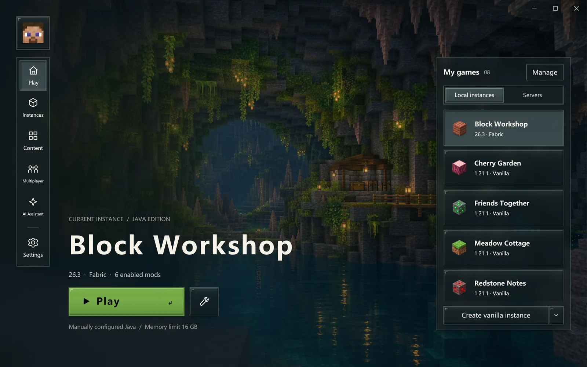
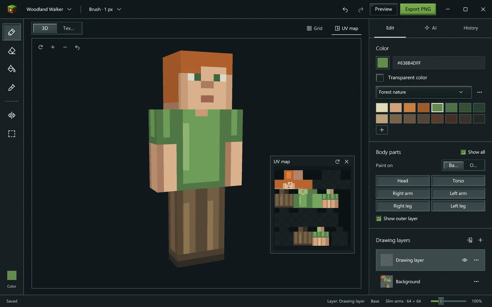
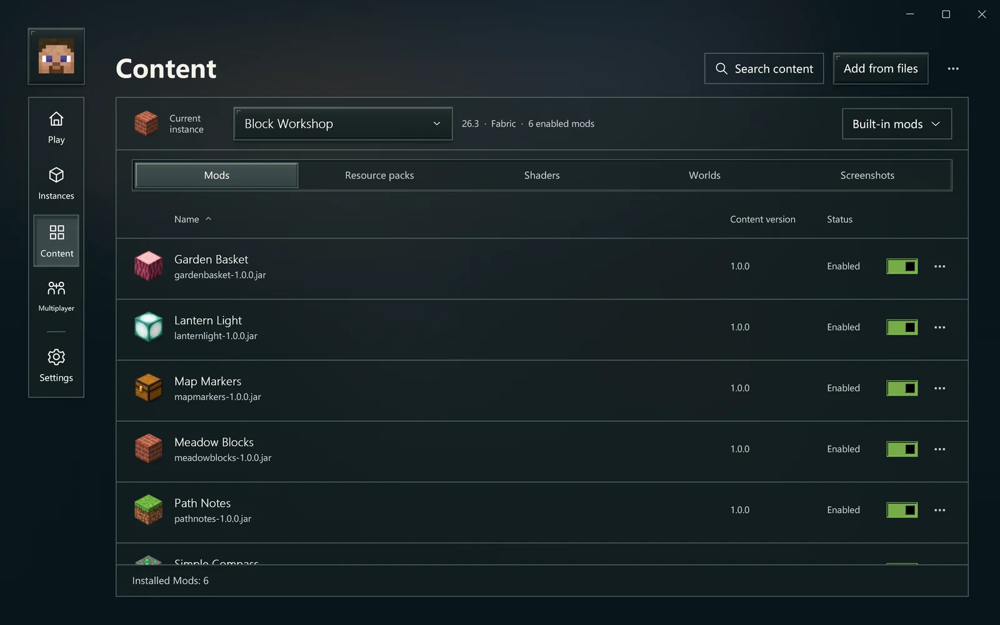
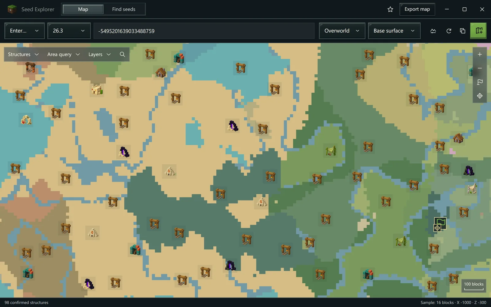
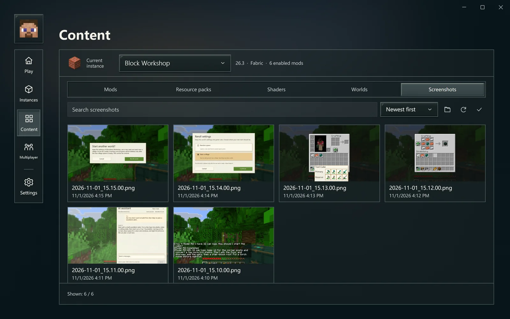
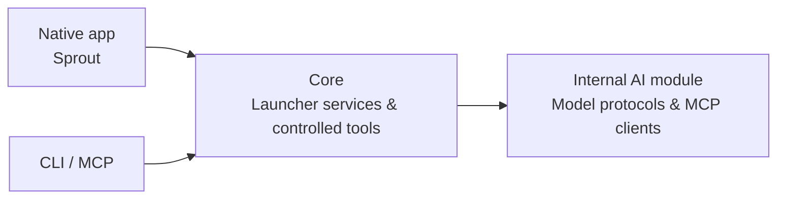

<div align="center">
  
  <h1>RMCL</h1>
  <p><strong>A native Windows launcher for Minecraft: Java Edition.</strong></p>
  <p>Your games, your worlds, your next idea — in one place.</p>
  <p>
    <strong>English</strong> · <a href="README.zh-CN.md">简体中文</a>
  </p>
  <p>
    
    
    
    
    
  </p>
  <p>
    <a href="https://rmcl.richasy.net/en/">Website</a> ·
    <a href="https://rmcl.richasy.net/en/docs/">Player handbook</a> ·
    <a href="https://github.com/Richasy/Rodel.MinecraftLauncher/issues">Feedback</a>
  </p>
  <a href="https://apps.microsoft.com/detail/9MW9ZMS2K47C">
    
  </a>
</div>

> [!IMPORTANT]
> **This project cannot currently be built from source.**
> Its native UI framework, **Sprout**, is still under closed development, and the required framework dependencies are not publicly available. This README therefore does not offer a public source-build procedure.
>
> **To use RMCL, install the released app from [Microsoft Store](https://apps.microsoft.com/detail/9MW9ZMS2K47C).** The source-build limitation does not prevent installing the Store release.

**RMCL — Rodel Minecraft Launcher** is a free Windows launcher written in C# and .NET, with a self-developed launch core and a native interface built on Sprout. It connects everyday game management with creative tools: prepare an instance, organize its content, keep a world backup, design a skin, or explore your next seed.

The project is also a practical exploration of native desktop UI and **AI assistance for Minecraft players**. AI is optional; you can manage and launch games without configuring a model service.

<p align="center">
  <a href="https://rmcl.richasy.net/en/docs/start/first-launch/">
    
  </a>
</p>

<p align="center">
  <a href="#get-started">Get started</a> ·
  <a href="#features">Features</a> ·
  <a href="#creative-tools">Creative tools</a> ·
  <a href="#gallery">Gallery</a> ·
  <a href="#ai">AI</a> ·
  <a href="#built-in-mods">Built-in mods</a> ·
  <a href="#cli-mcp">CLI &amp; MCP</a> ·
  <a href="#documentation">Documentation</a>
</p>

---

<a id="get-started"></a>
## 🚀 Get started

**RMCL is available from Microsoft Store and as a [GitHub Release EXE installer](https://github.com/Richasy/Rodel.MinecraftLauncher/releases/latest).** Use the Store to update the Store edition, or download EXE updates from Releases. Game, mod and modpack updates remain inside the launcher.

| Requirement | What you need |
| --- | --- |
| Operating system | Windows 10 version 2004, build **19041**, or later, including Windows 11 |
| Architecture | **x64** or **ARM64**; the Store selects the appropriate package |
| Launcher runtime | NativeAOT releases do **not** require a separate .NET installation |
| Minecraft runtime | A suitable **Java** runtime for your game version; discover, import or prepare it through the launcher |
| Storage and network | Space for games, resources and backups; initial preparation normally needs downloads |

### Your first game, step by step

1. **Install and open RMCL** from Microsoft Store or GitHub Releases.
2. **Choose an identity.** Add a Microsoft account, use an offline identity for supported local scenarios, or select a compatible external authentication service.
3. **Create or import an instance.** Start with vanilla Minecraft, copy in an existing game folder, or import an MRPack or CurseForge ZIP.
4. **Let preparation finish.** Check the overall task result for game files, the loader and Java, rather than treating one download's 100% as completion.
5. **Select the instance and play.** Wait for Minecraft itself to finish loading before entering a world or server.

The Store release includes the public Client ID needed to initiate Microsoft sign-in. Players do not need to register an Azure application or configure a Client ID themselves. Actual account entitlement and service access still apply; an offline identity does not bypass game ownership or server authentication.

> [!TIP]
> **Already have a setup you like?** The app imports an existing game by making a complete managed copy, not by linking back to the old folder. The source is left untouched.
>
> Game data defaults to **`%USERPROFILE%\.rmcl`**. Changing the data folder in Settings takes effect after restarting and **does not move existing data**.

Continue with [Installation & requirements](https://rmcl.richasy.net/en/docs/start/install/), [Your first launch](https://rmcl.richasy.net/en/docs/start/first-launch/) or [Import an existing game](https://rmcl.richasy.net/en/docs/play/import/).

<a id="features"></a>
## ✨ Everyday launcher features

An instance keeps one game setup together: its version, configuration, mods and worlds. RMCL separates instance game content from reusable runtime dependencies, so you can maintain different setups without mixing their files.

| Area | What you can do |
| --- | --- |
| **Instances** | Create, rename, configure, copy and migrate setups; keep game content independent while reusing compatible dependencies. |
| **Game preparation** | Prepare Minecraft, Java and supported Fabric, Quilt, Forge or NeoForge combinations; inspect launch settings and recover from interrupted preparation. |
| **Mods & content** | Discover content on Modrinth, review exact versions and dependencies, install or update selected files, and manage local mods, resource packs and shaders. |
| **Modpacks** | Inspect, import and export MRPack and CurseForge ZIP files; stage missing files and continue preparation without creating a duplicate instance. |
| **Worlds & backups** | Browse, import, export, back up and restore worlds, with explicit handling of locks, confirmation and recovery. |
| **Servers** | Save favorites, associate suitable client instances, inspect available status information and launch directly into a server. |
| **Play with friends** | Create or join optional **Terracotta** rooms, invite friends and manage the associated local game. **This remains a preview feature.** |
| **Screenshots** | Browse an instance gallery, search and sort filenames, select multiple images, open them externally, rename, copy or export them, and distinguish recycling from permanent deletion. |
| **Tasks & diagnostics** | Observe persistent background tasks, request cancellation, inspect game sessions and errors, and export launcher logs or game diagnostic reports. |
| **Preferences** | Adjust Java, memory, downloads, proxies, mirrors, appearance and language; valid global and instance settings save automatically. |

**A few boundaries matter:**

- **CurseForge online access is not enabled by default**, and no CurseForge API key is read. Its offline ZIP workflow remains available; Modrinth online workflows are implemented.
- **Terracotta multiplayer is a preview and is disabled by default in app settings.** Network readiness is not proof of successful Minecraft authentication or joining; cross-network compatibility is not a blanket guarantee.
- Enabling a resource pack or shader file in the launcher is not the same as selecting it inside Minecraft.

<details>
<summary><strong>Available in 15 display languages</strong></summary>

English · 简体中文 · 繁體中文 · 日本語 · 한국어<br />
Deutsch · Français · Español · Português (Brasil) · Русский<br />
Italiano · Polski · Türkçe · Bahasa Indonesia · العربية

The app and CLI share these languages. The CLI accepts `--language CODE`; command names and protocol fields remain unchanged. See the [language reference](doc/CLI.md).

</details>

<a id="creative-tools"></a>
## 🎨 Make Minecraft your own

### Skin & cape designer

An independent editor gives you room to work on a character, rather than squeezing every operation into a launcher settings page.

- Work with **Classic and Slim** skins, **64×64 and 128×128** projects, and capes.
- Paint in **3D**, use a flat texture view, and inspect the **UV layout**.
- Combine layers, selections, transparency masks, mirrored painting and opposite-limb copying.
- Create local palettes, extract colors from reference images, and sample **original image pixels** with an eyedropper and magnifier.
- Preview outfits and a walking character; keep a unified undo/redo history and export PNG files.
- Optionally use AI to edit the current project within its scoped editing workflow.

**Useful shortcut:** hold **Ctrl + left-drag** to pan the view.

[Explore the skin designer →](https://rmcl.richasy.net/en/docs/create/skins/)

### Seed explorer & world maps

Find a starting point that fits your plans before committing to a new world.

- Explore progressive terrain maps across the **Overworld, Nether and End**.
- Locate structures and inspect selected areas using the exact vanilla runtime.
- Search for combinations of biomes and structures, and keep searches and favorites.
- Export maps as PNG, or open a selected saved world's map without modifying the save.

**The currently verified seed-generation target is Minecraft 26.3 with Java 25.** Other versions are not silently approximated, and a base terrain map is not a fully decorated generated world.

[Explore seeds and maps →](https://rmcl.richasy.net/en/docs/create/seed-explorer/)

<a id="gallery"></a>
## 🖼️ A closer look

Select a screenshot to open its guide.

<table>
  <tr>
    <td width="50%">
      <a href="https://rmcl.richasy.net/en/docs/create/skins/"></a>
      <p align="center"><strong>Skin &amp; cape designer</strong><br />3D painting, layers and character previews</p>
    </td>
    <td width="50%">
      <a href="https://rmcl.richasy.net/en/docs/play/content/"></a>
      <p align="center"><strong>Content management</strong><br />Mods, resource packs, shaders and worlds</p>
    </td>
  </tr>
  <tr>
    <td width="50%">
      <a href="https://rmcl.richasy.net/en/docs/create/seed-explorer/"></a>
      <p align="center"><strong>Seed explorer</strong><br />Terrain, structures and your next starting point</p>
    </td>
    <td width="50%">
      <a href="https://rmcl.richasy.net/en/docs/play/screenshots/"></a>
      <p align="center"><strong>Screenshot gallery</strong><br />Browse, organize and export your moments</p>
    </td>
  </tr>
</table>

These are native-app captures with documentation example instances and projects, not HTML prototypes. They come from multiple releases; appearance may differ from the current app. See [image sources and capture details](website/ASSETS.md).

<a id="ai"></a>
## 🤖 Optional AI, connected to real launcher tools

The assistant is intended to help with a **specific player task**, not just produce a generic answer.

- Explain versions, loaders, dependencies and launch errors.
- Read the selected instance's information and relevant tool results.
- Find compatible content and help with preparation or diagnosis within granted permissions.
- Work on skin projects using the editor's actual tools.
- Keep launcher conversations, stream responses and present operation approvals or failures.

For example:

> Check this instance's version and loader, explain what it needs, and do not change any files yet.

Configure an **OpenAI-compatible**, **Anthropic-compatible** or **Gemini** service under **Settings → AI**, then choose a model. Ordinary new conversations default to **Safe**, with approval before write operations; file, instance and content scope checks still apply. Specialized skin and in-game workflows have their own scoped permissions.

With the optional **Rodel AI** mod, use **`/rai`** or the pause-menu sidebar for follow-up questions in Minecraft. Where supported by the game bridge, the assistant can use actual recipes, visible quest progress and unlocked handbook information. Game conversations are temporary for that game process and world; they do not enter persistent launcher history, and **`/rai_new`** clears the current world's conversation, not the world.

> [!NOTE]
> **The current release offers online model services only.** Local GGUF inference is temporarily unavailable. Existing local configuration is retained rather than silently replaced with an online model.
>
> Requests and the context actually included are sent to the **provider you select**. Provider fees and data policies apply. AI is not an autonomous gameplay bot or a guarantee that a problem will be fixed; the game bridge keeps server access **read-only**.

[AI assistant guide](https://rmcl.richasy.net/en/docs/create/assistant/) · [In-game AI guide](https://rmcl.richasy.net/en/docs/create/game-ai/) · [Privacy & data](https://rmcl.richasy.net/en/docs/project/privacy/)

<a id="built-in-mods"></a>
## 🧩 Three optional built-in mods

Open **Content → Mods → Built-in mods** to choose the modules available for the selected instance. Matching dependencies, including Fabric API where needed, ship with the launcher: players do not need JDK, Gradle or a source checkout to install them.

| Mod | What it adds |
| --- | --- |
| [**Rodel AI**](https://rmcl.richasy.net/en/docs/create/game-ai/) | In-game conversation through `/rai` and a pause-menu sidebar, sharing Core's model configuration and controlled tools. |
| [**World Reroll**](https://rmcl.richasy.net/en/docs/mods/world-reroll/) | Start again with a new seed while keeping world settings. The exact source save is removed **only after the replacement world is ready**; failure preserves it. |
| [**BetterTools / Tool Cube**](https://rmcl.richasy.net/en/docs/mods/bettertools/) | Store primary and reserve equipment in ten slots and switch real tools for the task, preserving item components, enchantments and individual durability. |

Availability depends on the exact **Minecraft version and loader**. Check the [compatibility matrix](mods/COMPATIBILITY.md) and [installation guide](https://rmcl.richasy.net/en/docs/play/built-in-mods/) rather than assuming every module supports every setup.

**Rodel UI is no longer bundled.** Its source remains a separate visual experiment; these three mods do not depend on it. Existing player installations are not automatically removed or disabled.

<a id="cli-mcp"></a>
## ⌨️ CLI & MCP integration

The separate **`rodel-mc.exe`** entry point exposes launcher operations for scripts, diagnosis and external AI clients. Its MCP server wraps the same Core tool contracts instead of implementing a second launcher.

> These examples describe the interface for an environment with an existing, separately supplied CLI. **The Microsoft Store app does not include the CLI**, and this section is not a CLI download or source-build procedure.

```powershell
rodel-mc --language en --help
rodel-mc --data-dir C:\RMCL-Sandbox instance list
rodel-mc --data-dir C:\RMCL-Sandbox mcp serve --stdio
```

Use an explicit, isolated **`--data-dir`** for development and automation. The CLI does not read the app's packaged preference for a custom data directory.

For clients that use an `mcpServers` configuration, the connection takes this form; replace both paths with your actual CLI installation and intended data folder:

```json
{
  "mcpServers": {
    "rmcl": {
      "command": "C:\\Tools\\RMCL\\rodel-mc.exe",
      "args": [
        "--data-dir",
        "C:\\RMCL-Sandbox",
        "mcp",
        "serve",
        "--stdio"
      ]
    }
  }
}
```

The native app calls Core directly; it does **not** launch a CLI/MCP loopback to run its built-in assistant. A submitted task or a successful tool response is not proof that a game, world or server connection is ready.

See the [CLI reference](doc/CLI.md), [AI & MCP reference](doc/AI.md) and [Core API](doc/CORE_API.md) for command semantics, tool scopes and result handling.

<a id="architecture"></a>
## 🏗️ Architecture & development status

Two product entry points, one business core:



**Core owns configuration, sessions, permissions, tasks and launcher business logic.** Microsoft.Extensions.AI drives the model/tool loop, with Core retaining authorization and effect checks. The internal Assistant module is an implementation dependency, not a separately published assistant executable.

| Location | Responsibility |
| --- | --- |
| [Native app](src/Rodel.MinecraftLauncher.App/README.md) | Sprout UI, packaged MSIX lifecycle and presentation |
| [Core](src/Rodel.MinecraftLauncher.Core/) | Shared launcher services, state, tasks and controlled tools |
| [CLI](src/Rodel.MinecraftLauncher.Cli/) | Command tree and external MCP server |
| [Internal AI module](src/Rodel.MinecraftLauncher.Assistant/) | Model protocol implementations and MCP client transport |
| [Skin library](src/Rodel.Minecraft.Skins/) / [Seed library](src/Rodel.Minecraft.Seeds/) | Independent editing and vanilla seed-exploration capabilities |
| [Game mods](mods/README.md) | Separate Java/Gradle modules and bundled compatibility targets |
| [Website](website/README.md) | Bilingual player handbook and documentation assets |
| [Tests](test/README.md) | Formal MSTest regressions using .NET 11 and Microsoft.Testing.Platform |

### Why there are no build instructions here

**Sprout is still under closed development, so this project cannot currently be built from this repository.** Publicly usable framework dependencies are not available at this stage. Architecture, release and test documents describe the project's internal engineering work; they should not be mistaken for a currently reproducible public build path.

Project-authored launcher code is open source under **[GNU AGPL v3 (AGPL-3.0-only)](LICENSE)**. See [NOTICE](NOTICE) for copyright and independent-component scope. Framework dependency availability is separate from the launcher source license.

<a id="documentation"></a>
## 📚 Find the right guide

The player handbook is available in **English and Simplified Chinese**, with illustrated, task-oriented instructions.

| I want to… | Start here |
| --- | --- |
| Install RMCL or launch my first game | [Installation](https://rmcl.richasy.net/en/docs/start/install/) · [First launch](https://rmcl.richasy.net/en/docs/start/first-launch/) |
| Move an existing setup or use a modpack | [Import a game](https://rmcl.richasy.net/en/docs/play/import/) · [Modpacks](https://rmcl.richasy.net/en/docs/play/modpacks/) |
| Install content or protect a world | [Mods & resources](https://rmcl.richasy.net/en/docs/play/content/) · [Worlds & backups](https://rmcl.richasy.net/en/docs/play/worlds/) |
| Join a server or play with friends | [Servers](https://rmcl.richasy.net/en/docs/play/servers/) · [Terracotta preview](https://rmcl.richasy.net/en/docs/play/multiplayer/) |
| Design a character or find a seed | [Skins & capes](https://rmcl.richasy.net/en/docs/create/skins/) · [Seed explorer](https://rmcl.richasy.net/en/docs/create/seed-explorer/) |
| Configure AI or use it in Minecraft | [AI assistant](https://rmcl.richasy.net/en/docs/create/assistant/) · [Rodel AI](https://rmcl.richasy.net/en/docs/create/game-ai/) |
| Organize screenshots or adjust preferences | [Screenshots](https://rmcl.richasy.net/en/docs/play/screenshots/) · [Settings](https://rmcl.richasy.net/en/docs/create/settings/) |
| Understand an error or share a report | [Launch problems](https://rmcl.richasy.net/en/docs/help/launch/) · [Logs & feedback](https://rmcl.richasy.net/en/docs/help/feedback/) |

<details>
<summary><strong>Engineering references &amp; current validation status</strong></summary>

Repository technical documentation is currently primarily in Chinese.

- **Architecture & APIs:** [Architecture](doc/ARCHITECTURE.md) · [Core API](doc/CORE_API.md)
- **Commands & AI:** [CLI](doc/CLI.md) · [AI](doc/AI.md) · [Managed tools](doc/AI-MANAGED-TOOLS.md)
- **Scope:** [Feature alignment](doc/ALIGNMENT.md) · [Development goals](doc/DEVELOPMENT.md) · [Restrictions](doc/RESTRICTIONS.md)
- **Design:** [Design entry](design/README.md) · [Design specification](design/DESIGN.md) · [Interactive prototype](design/index.html)
- **Tests:** [Test entry points](test/README.md) · [Test design guidelines](test/GUIDELINES.md) · [AI test boundaries](test/ASSISTANT.md)
- **Release & collaboration:** [Release workflow](doc/RELEASE.md) · [Collaboration guide](AGENTS.md)

Prototypes and documentation captures are not runtime dependencies or gameplay acceptance evidence. Regression tests, NativeAOT packages, native UI checks, actual Minecraft runs and Store certification have separate validation scopes; consult the current state rather than inferring one from another.

</details>

<a id="feedback"></a>
## 💬 Feedback, privacy & project notes

**RMCL is free to use.** Minecraft ownership and optional model-provider charges are separate. The project remains a native UI and AI experiment; it does not promise to replace other launchers or support every game/mod combination.

For problems and suggestions, prefer [GitHub Issues](https://github.com/Richasy/Rodel.MinecraftLauncher/issues). Include:

- Your RMCL version, Windows version and architecture.
- The Minecraft version, loader and relevant modpack.
- Reproduction steps, expected behavior and the complete observed error.
- A relevant exported report or screenshot, **after checking it for private information**.

Do not publish API keys, account tokens, room invitation codes, private addresses or complete player data folders. Local data storage does not make all files safe to share, and online AI sends the context it uses to the selected provider.

[Privacy & data](https://rmcl.richasy.net/en/docs/project/privacy/) · [Terms & limitations](https://rmcl.richasy.net/en/docs/project/terms/) · [About RMCL](https://rmcl.richasy.net/en/docs/project/about/)

Project-authored launcher code is licensed under [AGPL-3.0-only](LICENSE). Independent modules and third-party components retain their original licenses and notices; see [NOTICE](NOTICE), the app's About page and the relevant modules.
