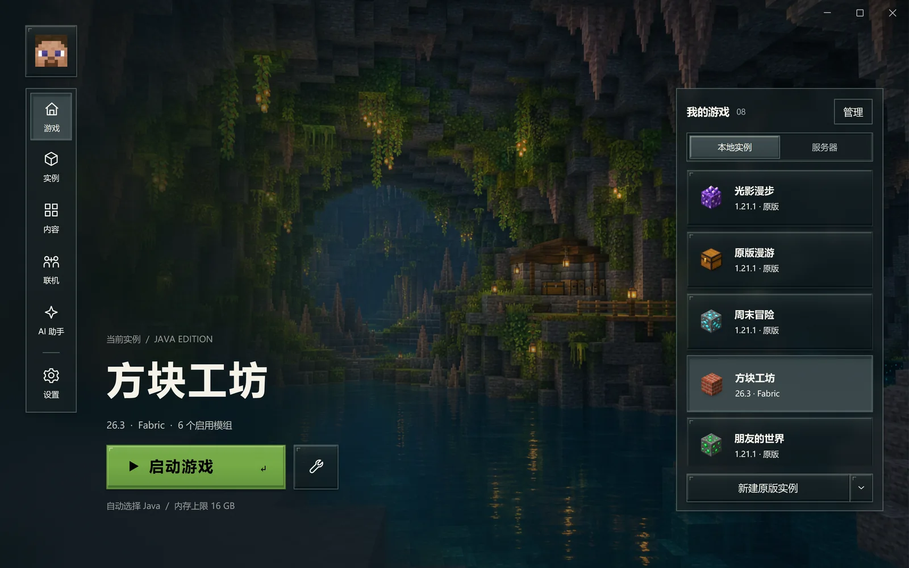
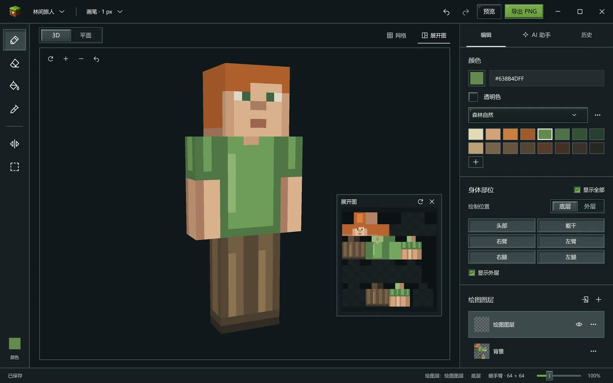
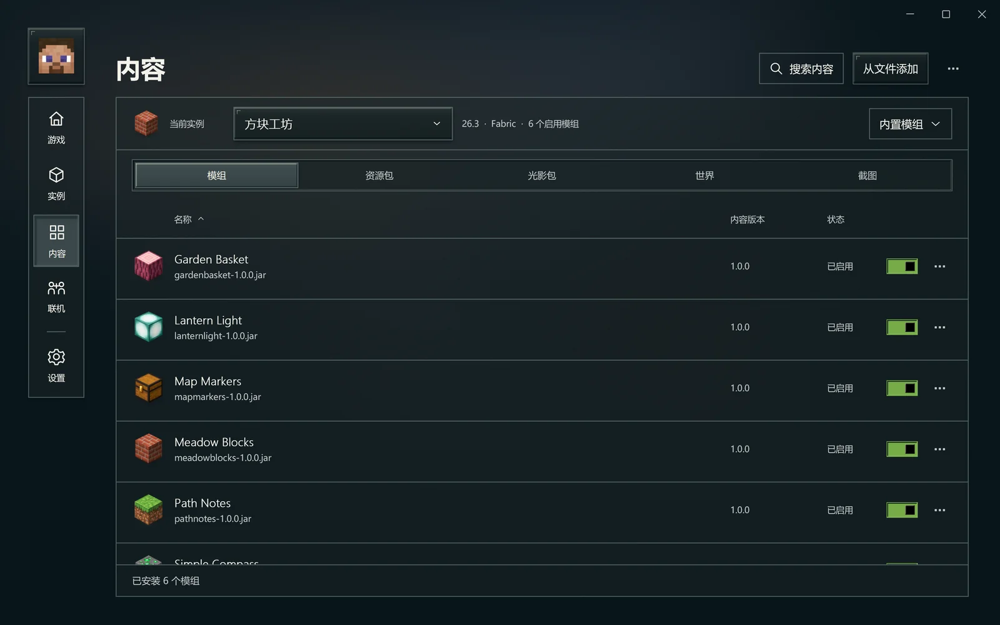
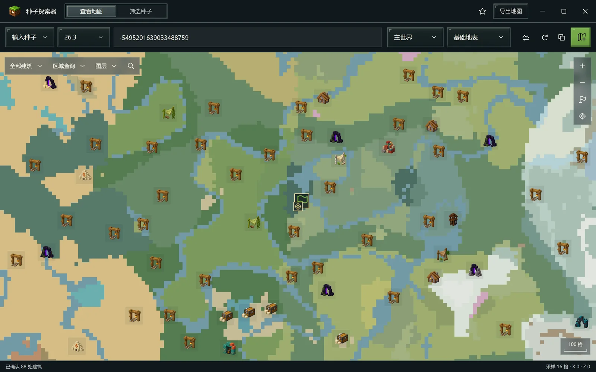
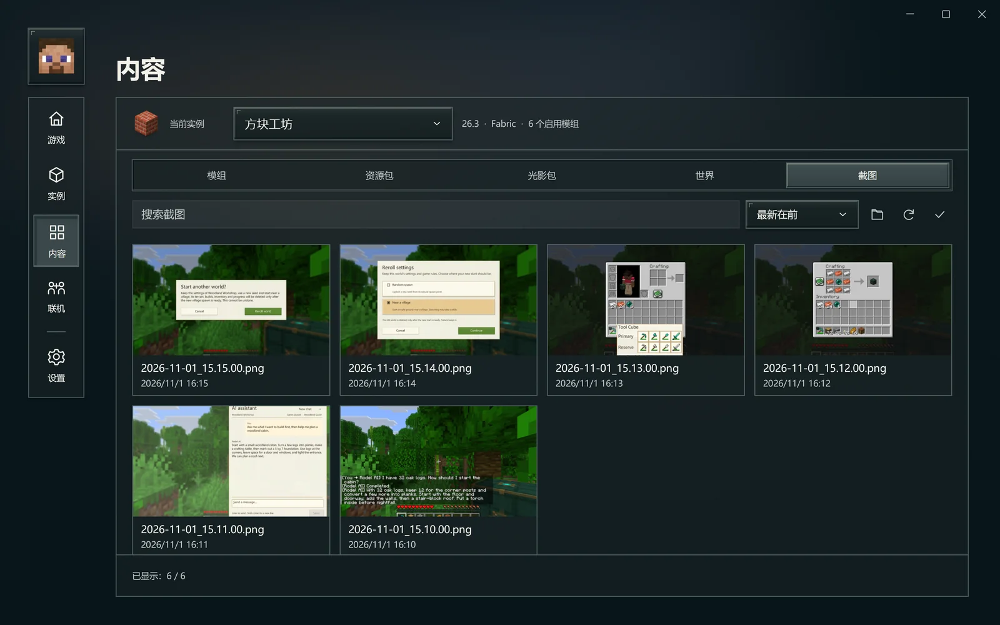
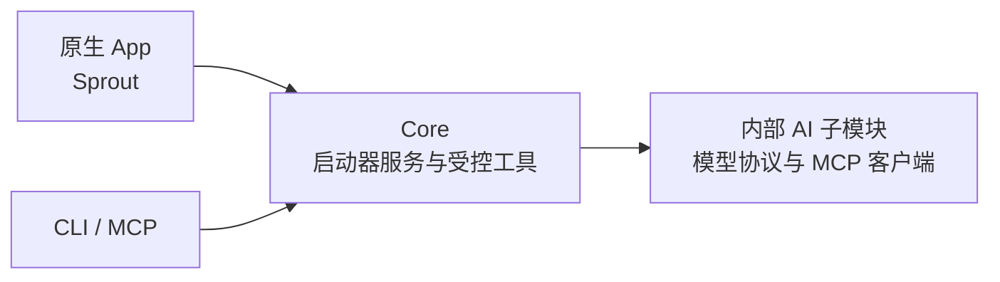

<div align="center">
  
  <h1>RMCL</h1>
  <p><strong>面向 Windows 的 Minecraft Java 原生启动器。</strong></p>
  <p>管理你的游戏，安顿你的世界，开启下一个灵感。</p>
  <p>
    <a href="README.md">English</a> · <strong>简体中文</strong>
  </p>
  <p>
    
    
    
    
    
  </p>
  <p>
    <a href="https://rmcl.richasy.net/">项目网站</a> ·
    <a href="https://rmcl.richasy.net/docs/">玩家手册</a> ·
    <a href="https://github.com/Richasy/Rodel.MinecraftLauncher/issues">问题反馈</a>
  </p>
  <a href="https://github.com/Richasy/Rodel.MinecraftLauncher/releases/latest">下载 Windows 版 RMCL · x64 / ARM64</a>
</div>

> [!IMPORTANT]
> **现阶段无法从源码构建本项目。**
> 原生 UI 框架 **Sprout** 仍处于封闭开发阶段，所需框架依赖尚未公开提供。因此，本 README 不提供当前不可用的公开源码构建步骤。
>
> **如需使用 RMCL，请从 [GitHub Releases](https://github.com/Richasy/Rodel.MinecraftLauncher/releases/latest) 下载安装包。** Microsoft Store 不再提供后续更新。

**RMCL — Rodel Minecraft Launcher** 是一款免费 Windows 启动器，使用 C# / .NET 自研启动内核，并以 Sprout 构建原生界面。它将日常游戏管理与创作工具放在一起：准备实例、整理内容、备份世界、绘制皮肤，或寻找下一次冒险的种子。

这个项目也在探索原生桌面 UI，以及**面向 Minecraft 玩家的 AI 辅助**。AI 是可选功能；不配置模型服务，也能管理和启动游戏。

<p align="center">
  <a href="https://rmcl.richasy.net/docs/start/first-launch/">
    
  </a>
</p>

<p align="center">
  <a href="#get-started">快速开始</a> ·
  <a href="#features">启动器功能</a> ·
  <a href="#creative-tools">创作工具</a> ·
  <a href="#gallery">界面预览</a> ·
  <a href="#ai">AI 助手</a> ·
  <a href="#built-in-mods">内置模组</a> ·
  <a href="#cli-mcp">CLI 与 MCP</a> ·
  <a href="#documentation">文档导航</a>
</p>

---

<a id="get-started"></a>
## 🚀 快速开始

**RMCL 通过 [GitHub Releases](https://github.com/Richasy/Rodel.MinecraftLauncher/releases/latest) 分发。** 选择 x64 或 ARM64 的 EXE 安装包。启动后会静默检查更新，标题栏更新图标可查看本地化说明、下载更新或跳过当前版本。游戏、模组和整合包更新仍在启动器内管理。

| 项目 | 要求与说明 |
| --- | --- |
| 操作系统 | Windows 10 2004、内部版本 **19041** 及以上，包括 Windows 11 |
| 处理器架构 | **x64** 或 **ARM64**；选择对应架构的安装包 |
| 启动器运行环境 | NativeAOT 发行版**不需要额外安装 .NET** |
| Minecraft 运行环境 | 适合所选游戏版本的 **Java**；可通过启动器发现、导入或准备 |
| 存储与网络 | 为游戏、资源和备份预留空间；首次准备通常需要下载文件 |

### 第一次启动，只需几步

1. **安装并打开 RMCL**：通过 GitHub Releases 获取应用。
2. **选择身份**：添加微软账户，在支持的本地场景使用离线身份，或选择兼容的外置认证服务。
3. **创建或导入实例**：从原版 Minecraft 开始，也可以复制迁入已有游戏目录，或导入 MRPack／CurseForge ZIP。
4. **等待完整准备结果**：核对游戏文件、加载器和 Java 的整体任务状态，不把单个下载的 100% 当作全部完成。
5. **选择实例并启动**：等待 Minecraft 本身完成加载，再进入世界或服务器。

发行版已内置发起微软登录所需的公开 Client ID，普通玩家不必自行注册 Azure 应用或配置 Client ID。账户的游戏权益和服务访问仍按实际条件验证；离线身份不绕过游戏所有权或服务器认证。

> [!TIP]
> **已经有一套顺手的配置？** App 导入已有游戏时，会完整复制为托管实例，而不是关联旧目录；来源始终不删改。
>
> 游戏数据默认位于 **`%USERPROFILE%\.rmcl`**。在设置中更改数据目录需要重启生效，**不会自动搬迁已有数据**。

详细步骤见[安装与准备](https://rmcl.richasy.net/docs/start/install/)、[第一次启动游戏](https://rmcl.richasy.net/docs/start/first-launch/)和[导入已有游戏](https://rmcl.richasy.net/docs/play/import/)。

<a id="features"></a>
## ✨ 日常启动器功能

实例是一套游戏配置的独立空间，包含版本、设置、模组和世界。RMCL 将实例游戏内容与可复用的运行依赖分开管理，方便保留不同玩法，不把它们的文件混在一起。

| 功能 | 你可以做什么 |
| --- | --- |
| **实例管理** | 新建、重命名、配置、复制和迁入实例；游戏内容独立保存，兼容依赖按需共享。 |
| **游戏准备** | 准备 Minecraft、Java 及支持的 Fabric／Quilt／Forge／NeoForge 组合，检查启动设置，并从中断的准备流程恢复。 |
| **模组与内容** | 在 Modrinth 发现内容，审核精确版本与依赖，安装或更新所选文件，管理本地模组、资源包和光影。 |
| **整合包** | 检查、导入和导出 MRPack／CurseForge ZIP，暂存缺失文件，在原实例继续准备，不重复创建。 |
| **世界与备份** | 浏览、导入、导出、备份和恢复世界，保留锁定、确认与恢复边界。 |
| **服务器** | 保存收藏、关联合适的客户端实例、查看可用状态，并直接启动连接服务器。 |
| **好友联机** | 使用可选的**陶瓦联机**创建或加入房间、邀请朋友，并管理关联的本地游戏。**目前仍为预览功能。** |
| **截图图库** | 按实例浏览截图，按文件名搜索／排序，多选、外部打开、改名、复制和导出，明确区分回收站与永久删除。 |
| **任务与诊断** | 观察持久化后台任务、请求取消、查看游戏会话与错误，导出启动器日志或游戏诊断报告。 |
| **设置与偏好** | 调整 Java、内存、下载、代理、镜像、外观和语言；有效的全局与实例设置自动保存。 |

**有几项边界需要说明：**

- **CurseForge 默认不开启在线访问，也不读取 API key。** CF ZIP 离线流程保留；Modrinth 在线流程已有实现。
- **陶瓦联机仍为预览，App 设置默认关闭。** 网络就绪不代表 Minecraft 认证或实际入服成功，也不承诺所有跨网络场景都兼容。
- 在启动器中启用资源包或光影文件，不等于已经在 Minecraft 内选中。

<details>
<summary><strong>支持 15 种显示语言</strong></summary>

English · 简体中文 · 繁體中文 · 日本語 · 한국어<br />
Deutsch · Français · Español · Português (Brasil) · Русский<br />
Italiano · Polski · Türkçe · Bahasa Indonesia · العربية

App 与 CLI 共用这组语言。CLI 可通过 `--language CODE` 选择语言，命令名称和协议字段保持不变，详见[语言说明](doc/CLI.md)。

</details>

<a id="creative-tools"></a>
## 🎨 玩出自己的样子

### 皮肤与披风编辑器

独立编辑器为人物创作提供完整工作空间，而不是把所有操作挤进启动器设置页。

- 支持 **Classic／Slim** 皮肤、**64×64／128×128** 工程和披风。
- 在 **3D** 中绘制，也可以使用平面贴图与 **UV 布局**。
- 组合图层、选区、透明蒙版、镜像绘制与对侧肢体复制。
- 创建本地色板，从参考图提取颜色，通过滴管与放大镜精确读取**原图像素**。
- 查看搭配与人物行走预览，保留统一撤销／重做历史，并导出 PNG。
- 可选 AI 直接编辑当前工程，沿用编辑器自身的限定范围。

**实用快捷键：**按住 **Ctrl + 左键拖动**平移视图。

[了解皮肤编辑器 →](https://rmcl.richasy.net/docs/create/skins/)

### 种子探索与世界地图

在真正开始一个新世界之前，先看看它是否适合你的计划。

- 渐进查看**主世界、下界和末地**的地形地图。
- 通过精确版本的原版运行时定位结构、检查选定区域。
- 按群系与结构组合筛选种子，保留搜索与收藏。
- 导出 PNG 地图，或打开选定存档的地图，不修改存档内容。

**当前种子生成的实际验证目标为 Minecraft 26.3 / Java 25。** 不会为其他版本悄悄使用近似计算，基础地形地图也不等于完整装饰后的生成世界。

[了解种子与地图 →](https://rmcl.richasy.net/docs/create/seed-explorer/)

<a id="gallery"></a>
## 🖼️ 看看应用里面

点击截图，可打开对应使用指南。

<table>
  <tr>
    <td width="50%">
      <a href="https://rmcl.richasy.net/docs/create/skins/"></a>
      <p align="center"><strong>皮肤与披风编辑器</strong><br />3D 绘制、图层与人物预览</p>
    </td>
    <td width="50%">
      <a href="https://rmcl.richasy.net/docs/play/content/"></a>
      <p align="center"><strong>内容管理</strong><br />模组、资源包、光影与世界</p>
    </td>
  </tr>
  <tr>
    <td width="50%">
      <a href="https://rmcl.richasy.net/docs/create/seed-explorer/"></a>
      <p align="center"><strong>种子探索器</strong><br />地形、结构与下一次冒险的起点</p>
    </td>
    <td width="50%">
      <a href="https://rmcl.richasy.net/docs/play/screenshots/"></a>
      <p align="center"><strong>截图图库</strong><br />浏览、整理与导出游戏瞬间</p>
    </td>
  </tr>
</table>

这些图像是原生 App 使用文档示例实例与工程的实际截图，不是 HTML 原型。截图来自不同版本，外观可能与当前应用略有差异；来源见[图片与采集说明](website/ASSETS.md)。

<a id="ai"></a>
## 🤖 AI 可选，但连接真实能力

助手围绕一个**明确的玩家任务**提供帮助，而不仅是生成通用回答。

- 解释游戏版本、加载器、依赖与启动错误。
- 读取所选实例的信息和相关工具结果。
- 在授权范围内寻找兼容内容，协助准备或排查问题。
- 使用编辑器的真实工具处理皮肤工程。
- 保存启动器对话、流式呈现回答，并展示操作审批或失败原因。

例如，你可以这样开始：

> 检查这个实例的游戏版本与加载器，解释还缺什么，先不要修改任何文件。

在**设置 → AI**中配置 **OpenAI 兼容**、**Anthropic 兼容**或 **Gemini** 服务，再选择模型。普通新会话默认使用 **Safe／安全模式**，写操作前请求审批；文件、实例和内容范围检查仍然有效。皮肤编辑与游戏内对话各有自身的限定授权流程。

安装可选的 **Rodel AI** 模组后，可在 Minecraft 中通过 **`/rai`** 或暂停菜单侧栏连续追问。游戏桥支持时，助手可读取实际配方、可见任务进度与已解锁手册。游戏对话仅在本次游戏进程及对应存档范围内临时保留，不进入启动器持久历史；**`/rai_new`** 清理当前存档的对话，**不会删除世界**。

> [!NOTE]
> **当前发行版仅提供在线模型服务。** 本地 GGUF 推理暂不可用，已有本地配置保留，不会悄悄改选在线模型。
>
> 请求及实际纳入的上下文会发送至**你选择的模型服务商**，其计费与隐私规则仍然适用。AI 不是自动游玩 BOT，也不保证一定修好问题；游戏桥对服务器始终保持**只读**。

[AI 助手指南](https://rmcl.richasy.net/docs/create/assistant/) · [游戏内 AI 指南](https://rmcl.richasy.net/docs/create/game-ai/) · [隐私与数据](https://rmcl.richasy.net/docs/project/privacy/)

<a id="built-in-mods"></a>
## 🧩 三个可选内置模组

在**内容 → 模组 → 内置模组**中选择适合当前实例的模块。匹配依赖与所需 Fabric API 随启动器提供，玩家安装时不需要 JDK、Gradle 或源码目录。

| 模组 | 带来的能力 |
| --- | --- |
| [**Rodel AI**](https://rmcl.richasy.net/docs/create/game-ai/) | 通过 `/rai` 和暂停菜单侧栏在游戏内对话，共用 Core 的模型配置与受控工具。 |
| [**World Reroll／世界重开**](https://rmcl.richasy.net/docs/mods/world-reroll/) | 保留世界设置，换一个种子重新开始；**新世界就绪后**才删除精确来源存档，失败保留原世界。 |
| [**BetterTools／工具魔方**](https://rmcl.richasy.net/docs/mods/bettertools/) | 十格保存主用／备用装备，按场景切换真实工具，保留物品组件、附魔与各自耐久。 |

可用模块取决于精确的 **Minecraft 版本与加载器**。请查看[兼容性矩阵](mods/COMPATIBILITY.md)和[安装指南](https://rmcl.richasy.net/docs/play/built-in-mods/)，不默认所有模块都支持所有组合。

**Rodel UI 已撤出内置分发。** 源码保留为独立视觉实验，以上三个模组不依赖它；不会自动删除或禁用玩家已经安装的版本。

<a id="cli-mcp"></a>
## ⌨️ CLI 与 MCP 接入

独立入口 **`rodel-mc.exe`** 为脚本、诊断和外部 AI 客户端提供启动器操作。它的 MCP 服务包装同一套 Core 工具契约，不另写第二套启动器业务。

> 以下示例用于说明**已具备单独提供的 CLI** 时的接口用法。**App 安装包不包含 CLI**；本节不是 CLI 下载方式，也不是当前可用的源码构建步骤。

```powershell
rodel-mc --language zh-CN --help
rodel-mc --data-dir C:\RMCL-Sandbox instance list
rodel-mc --data-dir C:\RMCL-Sandbox mcp serve --stdio
```

开发和自动化应显式使用隔离的 **`--data-dir`**。CLI 不读取 App 包偏好中选择的自定义数据目录。

采用 `mcpServers` 配置的客户端可以使用以下连接形态；请将两个路径替换为实际 CLI 安装位置和目标数据目录：

```json
{
  "mcpServers": {
    "rmcl": {
      "command": "C:\\Tools\\RMCL\\rodel-mc.exe",
      "args": [
        "--data-dir",
        "C:\\RMCL-Sandbox",
        "mcp",
        "serve",
        "--stdio"
      ]
    }
  }
}
```

原生 App 直接调用 Core，**不会通过启动 CLI／MCP 回环执行内置 AI**。任务已提交或工具返回成功，不等于游戏、世界或服务器连接已经就绪。

命令语义、工具范围与结果处理见[CLI 说明](doc/CLI.md)、[AI 与 MCP 说明](doc/AI.md)和[Core API](doc/CORE_API.md)。

<a id="architecture"></a>
## 🏗️ 架构与开发状态

两个产品入口，共用一个业务内核：



**配置、会话、权限、任务与启动器业务均归 Core。** Microsoft.Extensions.AI 驱动模型／工具循环，Core 保留授权与效果守卫。内部 Assistant 是实现依赖，不是单独发布的助手 EXE。

| 入口 | 职责 |
| --- | --- |
| [原生 App](src/Rodel.MinecraftLauncher.App/README.md) | Sprout 界面、当前用户 EXE 生命周期与展示 |
| [Core](src/Rodel.MinecraftLauncher.Core/) | 共享启动器服务、状态、任务与受控工具 |
| [CLI](src/Rodel.MinecraftLauncher.Cli/) | 命令树与对外 MCP 服务 |
| [内部 AI 子模块](src/Rodel.MinecraftLauncher.Assistant/) | 模型协议实现与 MCP 客户端传输 |
| [皮肤库](src/Rodel.Minecraft.Skins/)／[种子库](src/Rodel.Minecraft.Seeds/) | 独立编辑能力与原版种子探索 |
| [游戏模组](mods/README.md) | 独立 Java／Gradle 模块与内置兼容目标 |
| [文档网站](website/README.md) | 双语玩家手册与文档素材 |
| [正式测试](test/README.md) | MSTest 回归，使用 .NET 11 / Microsoft.Testing.Platform |

### 为什么这里没有构建步骤

**Sprout UI 框架仍在封闭开发，因此目前无法从本仓库源码构建项目。** 现阶段所需框架依赖尚未公开可用。架构、发布与测试文档记录的是项目内部工程工作，不应被误认为当前已经具备可复现的公开构建路径。

启动器自有代码采用 **[GNU AGPL v3（AGPL-3.0-only）](LICENSE)** 开源，版权与独立组件范围见 [NOTICE](NOTICE)。框架依赖的公开状态与启动器源码许可分别说明。

<a id="documentation"></a>
## 📚 按你想做的事找文档

玩家手册提供**英文与简体中文**，按实际任务组织，并配有图文步骤。

| 我想…… | 从这里开始 |
| --- | --- |
| 安装 RMCL，第一次启动游戏 | [安装与准备](https://rmcl.richasy.net/docs/start/install/) · [第一次启动](https://rmcl.richasy.net/docs/start/first-launch/) |
| 搬入现有配置，或使用整合包 | [导入已有游戏](https://rmcl.richasy.net/docs/play/import/) · [整合包](https://rmcl.richasy.net/docs/play/modpacks/) |
| 添加内容，或保护一个世界 | [模组与资源](https://rmcl.richasy.net/docs/play/content/) · [世界与备份](https://rmcl.richasy.net/docs/play/worlds/) |
| 进入服务器，或和朋友联机 | [服务器](https://rmcl.richasy.net/docs/play/servers/) · [陶瓦联机预览](https://rmcl.richasy.net/docs/play/multiplayer/) |
| 设计人物，或寻找新种子 | [皮肤与披风](https://rmcl.richasy.net/docs/create/skins/) · [种子探索器](https://rmcl.richasy.net/docs/create/seed-explorer/) |
| 配置 AI，或在游戏内使用 | [AI 助手](https://rmcl.richasy.net/docs/create/assistant/) · [Rodel AI](https://rmcl.richasy.net/docs/create/game-ai/) |
| 整理截图，或调整偏好 | [截图管理](https://rmcl.richasy.net/docs/play/screenshots/) · [设置](https://rmcl.richasy.net/docs/create/settings/) |
| 理解错误，或提交反馈 | [启动问题](https://rmcl.richasy.net/docs/help/launch/) · [日志与反馈](https://rmcl.richasy.net/docs/help/feedback/) |

<details>
<summary><strong>工程文档与当前验证状态</strong></summary>

仓库技术文档目前主要使用中文。

- **架构与 API：**[实际架构](doc/ARCHITECTURE.md) · [Core API](doc/CORE_API.md)
- **命令与 AI：**[CLI](doc/CLI.md) · [AI](doc/AI.md) · [托管工具](doc/AI-MANAGED-TOOLS.md)
- **功能边界：**[对齐清单](doc/ALIGNMENT.md) · [开发目标](doc/DEVELOPMENT.md) · [限制约束](doc/RESTRICTIONS.md)
- **界面设计：**[设计入口](design/README.md) · [设计规范](design/DESIGN.md) · [可交互原型](design/index.html)
- **正式测试：**[测试入口](test/README.md) · [测试设计指南](test/GUIDELINES.md) · [AI 测试边界](test/ASSISTANT.md)
- **发布与协作：**[发布流程](doc/RELEASE.md) · [协作入口](AGENTS.md)

原型与文档配图不是运行依赖，也不是游戏验收证据。正式回归、NativeAOT 包、原生界面、实际 Minecraft 运行和安装器升级分别验证，请按当前状态判断，不由某一项通过推定其他项完成。

</details>

<a id="feedback"></a>
## 💬 反馈、隐私与项目说明

**RMCL 免费使用。** Minecraft 游戏权益与可选模型服务费用分别由对应提供方决定。本项目仍是原生 UI 与 AI 实验，不承诺替代其他启动器，也不保证每个游戏／模组组合都兼容。

问题与建议优先提交至 [GitHub Issues](https://github.com/Richasy/Rodel.MinecraftLauncher/issues)。建议提供：

- RMCL 版本、Windows 版本与处理器架构。
- Minecraft 版本、加载器和相关整合包。
- 复现步骤、预期行为，以及实际观察到的完整错误。
- 相关导出报告或截图，**发送前先检查私人信息**。

请勿公开 API key、账户令牌、房间邀请码、私人地址或完整玩家数据目录。数据保存在本地，不代表所有文件都适合分享；在线 AI 会将实际使用的上下文发送至所选服务商。

[隐私与数据](https://rmcl.richasy.net/docs/project/privacy/) · [使用约定与限制](https://rmcl.richasy.net/docs/project/terms/) · [关于 RMCL](https://rmcl.richasy.net/docs/project/about/)

启动器自有代码采用 [AGPL-3.0-only](LICENSE)；独立模块与第三方组件保留原许可证及声明，详见 [NOTICE](NOTICE)、App 关于页和对应模块。
