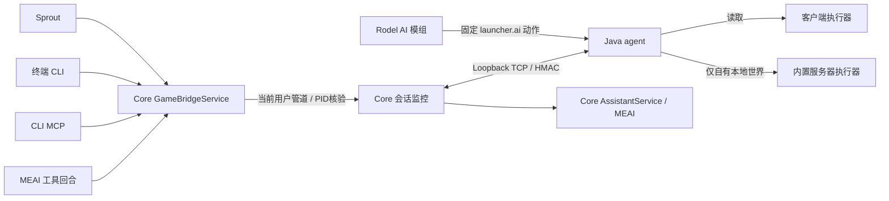

# Java游戏数据桥

Java agent、Core会话服务、CLI/MCP/AI和Sprout共用契约，Rodel AI模组经同一桥发起会话。本地可查询原生语义/NBT与整合包知识，并执行受世界及原权限约束的操作；远程服务器只读。加载器范围见[兼容矩阵](../mods/COMPATIBILITY.md)。

## 1. 采用的方案

使用**启动时Java agent → 本机有界TCP/JSON-RPC → Core会话监控 → CLI/Sprout**。内置AI直接调用Core受控工具，对外MCP由CLI包装相同契约；MEAI驱动模型/工具循环，不增加独立助手或第二套游戏服务。



一个Java17字节码JAR共用通信、反射绑定、线程调度、读写和归属检查，不要求安装Fabric/Forge或Rodel UI模组。混淆版本从官方SHA1校验过的client mappings生成小型精确绑定；26.3使用明确原名，Fabric经公开MappingResolver转换到运行时命名，继承接口方法沿真实层级解析。26.3时钟API是一个真实语义变化点，保留局部适配，没有逐MC版本复制工程。

桥默认开启，明确保存的全局／实例禁用仍优先，启动选项可临时覆盖。没有启用、Java低于17、映射不可用或绑定不支持时，普通游戏启动继续，并记录桥准备诊断；已运行且没有桥的游戏需下次启动启用。不做Attach、内存扫描、任意Java求值或在线存档文件改写。旧版映射优先复用Forge安装留下的原始Mojang映射，并按官方SHA1/大小校验；必要时在线下载。`--offline`仅使用已校验的本地文件，缺失时降级，不偷偷联网。Forge1.20.1运行时SRG成员名由实际MCP配置和官方映射组合，不猜测反射名称，支持共享依赖布局与原有未标记目录。

开发构建需JDK17或以上（`GameBridgeJavaHome`、可用JAVA_HOME或PATH）；脚本使用`javac --release 17`，生成JAR嵌入Core资源。玩家只需原有游戏Java，不需要JDK、Gradle、额外安装器或运行时下载桥二进制。

## 2. 数据与权限

| 当前实际世界 | 读取 | 修改 |
| --- | --- | --- |
| 主菜单、加载或退出世界 | `ready=false`及明确原因，不返回旧世界快照 | 拒绝 |
| 本地单人内置服务器 | 客户端同步位置、生命值、维度、时间；有界方块/实体/背包摘要 | 有界时间/生命、原生输入/容器/复活；命令另需原生允许作弊和玩家原权限 |
| 加入服务器、别人的LAN、同机独立服务端、Realms | 仅客户端已收到的数据，不加载额外区块 | 全部拒绝；localhost、OP4、AI允许操作不改变规则 |
| 本地单人开放LAN的宿主 | 按仍持有该内置服务器及memory connection判定 | 同本地规则；26.3原版已验证开放、重试与开放后查询，跨机器入服另行验证 |

Core先重新采样并检查本地归属，Java在入队及临执行前检查真实内置服务器、`isLocalServer`、memory connection、世界/玩家/连接身份及维度。写入必须带`gameIncarnation/worldEpoch/dimension/operationId`；重连、切世界或对象更换使旧授权失效。AI回合还冻结第一次成功观察的世界，后续快照不能把原许可悄悄转给新世界。同一localWorldEpoch内的维度切换/复活可用新快照更新当前epoch；换内置服务器不能沿用原回合授权，无根标识的旧快照保留严格冻结。

`world.publish` 在客户端原生执行器调用 IntegratedServer。存在 MultiplayerScope 的命名客户端从实际 JAR 识别该类型，采用 `publishServer(LAN, port)` 保留游戏模式、世界作弊与独立访客命令权限；旧客户端保留原 GameType／作弊参数接口。固定方法与 LAN 枚举先解析，再进入 applying；已知绑定缺失返回 rejected，真正进入原生调用后无法确认的效果仍为 unknown，不能重放。

位置/生命/时间快照与区域查询明确标为`client_synchronized`，不冒充服务端全知状态；applied收据中的修改后值由服务器API回读。客户端自然回血、时间推进等仍继续，applied不保证值永久不变，也不等于已经落盘。

### 游戏内AI请求

独立`mods/rodel-ai`只负责`/rai`、暂停入口和渲染，加载器范围见兼容矩阵，不持有provider密钥/SDK。它经系统classloader调用agent的`requestAi(String)`，只发送固定`launcher.ai` typed动作，不开放任意Java调用。agent在客户端执行器核对提交时的world对象并附加快照，Core再比较session/incarnation/epoch/dimension，防止排队后把消息转给新世界。

既有认证TCP现在双向复用，请求/响应按ID分流，共用发送锁；读取循环不等待反向处理器，因而C#可在处理AI入口时调用嵌套`game.snapshot`。Java与Core各限制最多8个反向待处理请求；同一2MiB帧上限、断连失败及不重放约定继续有效。`GameBridgeService.RequestAiAsync`和`process game ai SESSION --request JSON`经当前用户管道进入同一处理器，不添加让模型递归聊天的具名MCP工具。

动作包括`open/read/send/quick/new/cancel/confirm/answer`。Core按实例与存档身份的SHA256保存槽位引用，存档身份只用于哈希，不作为可读写路径；新会话先持久化重置身份和待清理会话，再复用既有删除审核/停止/移除逻辑，重复同一重置不删除后来建立的会话。消息复用Core ClientKey幂等提交；未知应答只观察或由用户以原身份重试，不自动重新生成模型回合。游戏监控退出取消自己发起且尚未结束的回合。

侧栏读取按时间排序的最近至多20条完整回合，页大小按传输预算缩小，早期记录仍可分页读取；超大单条消息明确要求在启动器查看，不静默截断。只投递显示所需的message_started/text_delta事件并保留耐久游标，不把provider/工具结果协议作为面板消息。控制台与侧栏共用当前存档会话，`quick/QuickId`按ClientKey返回确切提交的回合，不返回活动文本事件，终态才显示完整回答；并发排队不会让观察者误读最后一条消息。`/rai_new`与侧栏新会话共用清理。原生ChatScreen仅在提交`/rai`消息及其回复/新会话命令时保留打开并清空输入，Esc及普通命令保持原行为；AI状态替换采用当前GUI时间，不续用过期消息时间。所有对话/模型/上下文/MEAI工具/状态由C#既有AI实现拥有；游戏来源以既有AllowOperations授予本回合操作许可，不逐条确认游戏指令，全局默认模式和原生权限/世界/文件范围守卫不变。只有游戏来源回合追加纯文本、不用Markdown的系统指令。

## 3. 其它启动器与游戏桥如何做

从官方仓库浅检出并阅读下列固定提交。结论是源码证据，没有运行这些启动器或以它们进入游戏。检索范围是列出的启动/监控链路，不能据此证明整个生态不存在其它桥接能力。

| 对象、固定提交 | 实际阅读入口与源码事实 | 对Rodel的启示 |
| --- | --- | --- |
| Prism Launcher `6f5723937f558b06eb6795d16e0994299ba9c040` | [EntryPoint.java](https://github.com/PrismLauncher/PrismLauncher/blob/6f5723937f558b06eb6795d16e0994299ba9c040/libraries/launcher/org/prismlauncher/EntryPoint.java)：启动前读stdin参数，收到 `launch` 后调用Java launcher；[LauncherPartLaunch.cpp](https://github.com/PrismLauncher/PrismLauncher/blob/6f5723937f558b06eb6795d16e0994299ba9c040/launcher/minecraft/launch/LauncherPartLaunch.cpp)负责写入脚本及launch/abort。[SystemProperties.java](https://github.com/PrismLauncher/PrismLauncher/blob/6f5723937f558b06eb6795d16e0994299ba9c040/libraries/launcher/org/prismlauncher/SystemProperties.java)向模组暴露实例等属性。 | C++启动器与Java的进程通信已有直接参考；该入口是启动引导，不是持续读取玩家/世界的RPC桥。不能把“带Java辅助代码”视为已有实时游戏API。 |
| HMCL `b8c1738f968a8275a7ef9e27c536e83f4b6e516d` | [LauncherHelper.java / HMCLProcessListener](https://github.com/HMCL-dev/HMCL/blob/b8c1738f968a8275a7ef9e27c536e83f4b6e516d/HMCL/src/main/java/org/jackhuang/hmcl/game/LauncherHelper.java)：处理onLog/onExit，清理令牌、缓冲日志，以LWJGL等日志辅助判断启动。 | 即使两边都用Java，游戏仍是独立进程；同语言不会自动取得游戏对象。日志适合诊断，不能替代坐标/背包API。 |
| PCL `6b9a50df911c9d68b69b24c979efba477fb14b67` | [ModWatcher.vb](https://github.com/Meloong-Git/PCL/blob/6b9a50df911c9d68b69b24c979efba477fb14b67/Plain%20Craft%20Launcher%202/Modules/Minecraft/ModWatcher.vb)：通过.NET Process的输出事件读取日志，用LWJGL/OpenAL/材质日志和真实窗口信息跟踪加载及退出。 | 可复用.NET进程监控思路；这些信息不足以构建可靠的游戏状态修改器。 |
| Minescript `c1229ff625b639957e1a15b6d77aa7dc4e35e3d1`，游戏桥参照 | [SubprocessTask.java](https://github.com/maxuser0/minescript/blob/c1229ff625b639957e1a15b6d77aa7dc4e35e3d1/common/src/main/java/net/minescript/common/SubprocessTask.java)管理脚本子进程并回传JSON结果；[Job.java](https://github.com/maxuser0/minescript/blob/c1229ff625b639957e1a15b6d77aa7dc4e35e3d1/common/src/main/java/net/minescript/common/Job.java)按调用ID关联函数并分发到tick/render队列；[Minescript.java](https://github.com/maxuser0/minescript/blob/c1229ff625b639957e1a15b6d77aa7dc4e35e3d1/common/src/main/java/net/minescript/common/Minescript.java)在客户端循环处理队列，提供真实游戏数据。 | 跨语言的关键是游戏内接入、明确API、队列及结果关联。它是Java模组管理Python脚本，进程所有权和Rodel不同；不照搬stdout协议或任意脚本执行能力。 |

Minescript证明的是一种可核对的实现模式，没有证明Rodel桥已工作，也没有赋予服务器数据写权限。[其官方API文档](https://minescript.net/docs/)列出了玩家位置、背包等查询。参考仓库源码仅供研究，不复制进产品；若未来引入具体代码，需另核对相应文件许可。

[Mineflayer](https://github.com/PrismarineJS/mineflayer)是另一类方案：Node.js程序以Minecraft客户端/BOT身份连接服务器。它适合研究独立BOT，不能直接读取已经运行的玩家JVM里的UI和本地对象。游戏桥不提供独立BOT身份；游戏桥也不等于独立 AI 伙伴已经实现。

## 4. C# / Java互操作方案比较

先分清游戏接入和进程通信：TCP、WebSocket、gRPC只能传消息，本身不能让Java端获得Minecraft业务API。

### 4.1 游戏侧接入

| 方案 | 适用点和实际成本 | 建议 |
| --- | --- | --- |
| 加载器模组 | 可接真实生命周期、注册表、客户端/内置服务器线程；相容版本可能复用构建，但仍要验证游戏版本与加载器组合 | 保留为候选，与agent比较真实适配成本；不预设每个MC补丁版本都需要重写或单独产物 |
| 启动时 `-javaagent` | 可在应用main之前加载代码/做字节码变换，不要求加载器；仍要解决映射、类加载器、游戏语义和其它transformer冲突；agent启动失败可能使JVM启动失败 | 优先做跨版本可行性验证，基础版采用反射读取；生存操作扩展增加确切按键getter钩子，需按当前构建复验共存 |
| Attach / 运行中agent | 可在支持的JVM中加载agent，受JVM配置和环境影响；不提供现成游戏API | 首版不支持，已启动但未装桥的游戏明确提示下次启动启用 |
| JNI / Java FFM / NativeAOT导出DLL | 适合Java进程内调用原生库或原生进程嵌入JVM；跨GC、线程、ABI和故障边界成本较高 | 不为本机几KB级业务消息引入原生桥；`AttachCurrentThread`是线程加入同进程JVM，不是附加任意外部Java进程 |
| IKVM | 让Java字节码在.NET体系执行/转换；不能直接获得另一个HotSpot进程里的既有游戏对象 | 不用于接管真实Minecraft运行时 |
| JMX / JFR /日志 | JVM诊断或已有观测；游戏语义仍需定制MBean/事件 | 保留诊断职责，不把它们变成世界编辑接口 |
| 在线改NBT、options.txt或扫进程内存 | 容易绕过真实模型、缓存、校验和保存生命周期；离线文件并不反映当前权威状态 | 游戏运行时不采用；原有离线文件业务仍按自身契约维护 |

依据：[Java Instrumentation](https://docs.oracle.com/en/java/javase/25/docs/api/java.instrument/java/lang/instrument/package-summary.html)、[Attach API](https://docs.oracle.com/en/java/javase/25/docs/api/jdk.attach/com/sun/tools/attach/package-summary.html)、[JNI Invocation API](https://docs.oracle.com/en/java/javase/25/docs/specs/jni/invocation.html)、[IKVM项目说明](https://github.com/ikvmnet/ikvm)、[JMX管理说明](https://docs.oracle.com/en/java/javase/25/management/monitoring-and-management-using-jmx-technology.html)。Java25文档仍区分启动agent与运行中agent，并说明动态加载的警告/显式启用；本方案不声称所有新JDK已经统一禁止Attach。

### 4.2 进程通信与消息协议

| 选择 | 优点 | 对本项目的成本/边界 | 建议 |
| --- | --- | --- | --- |
| 本机TCP + 有界JSON-RPC | .NET / Java均有标准Socket；双向、易诊断、与游戏日志分离；不需要新原生DLL或HTTP宿主 | 自己落实长度边界、认证、背压、超时及生命周期；TCP不自动提供消息边界 | **当前采用** |
| WebSocket + JSON-RPC | 标准双向消息、后续接浏览器工具方便；JDK11起有标准客户端 | Core监听端要有HTTP/WebSocket服务端；仍需认证、消息大小及背压；没有浏览器直连需求 | 合理备选，不同时实现第二套传输 |
| gRPC + Protobuf | 跨语言IDL、生成类型、流、deadline等成熟；.NET有NativeAOT支持 | 引入Protobuf工具链、Java端库与HTTP/2宿主；多版本模组需要管理打包/类冲突 | 若真实吞吐/多客户端需求证明值得，再替换；**不能以不支持AOT为由排除它** |
| Windows命名管道 | .NET成熟，适合用户隔离、进程身份核验；仓库已有Core/App控制实例 | Java标准库没有与.NET NamedPipeClientStream对等的Windows管道API，需要Win32/JNA/JNI或经专项验证的文件句柄方案 | 保留给纯.NET控制平面；不为首版Java桥增加原生依赖 |
| Unix domain socket | 适合本机IPC，Java16起有标准地址类型 | 需要验证目标Windows/JDK组合、路径/权限和版本覆盖；与Windows命名管道不是同一API | 暂不采用，不声称Windows一概不支持 |
| stdin/stdout | 父子进程简单、无需端口；Prism和Minescript有可核对案例 | 本项目游戏stdout/stderr已有诊断用途；模组日志可能混入，重连和多入口访问困难 | 不与游戏日志共用协议通道 |
| 共享内存/文件轮询 | 大块数据或单向低频配置有用途 | 原子性、所有权、同步和恢复复杂；壁纸单向同步不能直接扩为通用RPC | 保留现有壁纸用途，首版不传世界状态 |

依据：[.NET TCP](https://learn.microsoft.com/en-us/dotnet/fundamentals/networking/sockets/tcp-classes)、[Java Socket](https://docs.oracle.com/en/java/javase/25/docs/api/java.base/java/net/Socket.html)、[Java WebSocket](https://docs.oracle.com/en/java/javase/25/docs/api/java.net.http/java/net/http/WebSocket.html)、[gRPC概念](https://grpc.io/docs/what-is-grpc/introduction/)、[gRPC NativeAOT支持](https://learn.microsoft.com/en-us/aspnet/core/grpc/native-aot?view=aspnetcore-10.0)、[.NET管道](https://learn.microsoft.com/en-us/dotnet/standard/io/pipe-operations)、[Java UnixDomainSocketAddress](https://docs.oracle.com/en/java/javase/25/docs/api/java.base/java/net/UnixDomainSocketAddress.html)。

### 4.3 维护成本：按什么划分兼容范围

**不需要预设每个MC版本重做一套桥；每个声明支持的组合仍要验证。** 接入方式、兼容代码、发布产物和验证矩阵是四件不同的事。

| 部分 | 目标复用方式 | 仍会变化的地方 |
| --- | --- | --- |
| C#服务、TCP/RPC、认证、订阅、限额、操作收据 | 保持一套业务实现，独立于MC类名 | 协议能力确实演进时修改，不因MC版本号变化复制 |
| Java桥通用逻辑 | 共用通信、DTO、生命周期和服务器只读检查的策略；最终世界归属证据由具体接入取得 | 最低Java运行时及字节码兼容；未证明时不承诺单JAR覆盖所有JVM |
| 游戏访问的小范围代码 | 按实际对象/方法签名、注册表结构及调度方式形成兼容组；相容补丁复用实现 | 混淆命名、方法签名、背包/物品数据、客户端/内置服务器生命周期等真实变化 |
| 启动/加载器接入 | agent争取减少加载器专用产物；模组可共用业务源码，分别保留必要入口 | agent同样要验证Fabric/Forge的类加载与变换链，不自动等于加载器无关 |
| 测试与发布 | 从已验证兼容组生成支持范围，逐项能力协商 | 发布支持新的MC组合必须有证据；不把编译成功或版本范围声明当作实机兼容 |

Fabric本身允许在依赖中声明[版本范围](https://wiki.fabricmc.net/documentation:fabric_mod_json_spec)，所以“采用模组”不必然等于“每个补丁版本一个项目/JAR”；范围声明也不保证调用的API保持兼容。agent则省去强制安装某种加载器，但若大量依赖字节码结构识别和反射猜测，维护成本可能高于模组公开事件/API。

可核对的agent参照是authlib-injector固定提交`879c6cbfce848f37e7da656d59a20cb93bd7102b`：[README.md](https://github.com/yushijinhun/authlib-injector/blob/879c6cbfce848f37e7da656d59a20cb93bd7102b/README.md)用`-javaagent`接入；[AuthlibInjector.java](https://github.com/yushijinhun/authlib-injector/blob/879c6cbfce848f37e7da656d59a20cb93bd7102b/src/main/java/moe/yushi/authlibinjector/AuthlibInjector.java)注册transformer；[YggdrasilKeyTransformUnit.java](https://github.com/yushijinhun/authlib-injector/blob/879c6cbfce848f37e7da656d59a20cb93bd7102b/src/main/java/moe/yushi/authlibinjector/transform/support/YggdrasilKeyTransformUnit.java)显式处理不同authlib类名/方法签名。这证明“共用agent加局部兼容处理”有实际实现，**没有证明**它已解决世界/背包/tick等跨度更大的游戏接口兼容。本轮在内存读取这些源文件，未新增参考源码落盘。

Mojang已宣布后续发行去掉混淆，[官方说明](https://www.minecraft.net/en-us/article/removing-obfuscation-in-java-edition)支持降低命名/映射成本的判断；不能从去混淆推导出内部API、对象结构或线程语义永久稳定，旧版混淆也不会因此消失。

兼容性验证已在三个原版版本及Fabric 1.21.1完成：一套agent实现配合官方映射/明确名称，读取位置/生命值、判定本地归属并在真实服务端线程修改生命值，结果见第8节。没有为三个版本分别编写业务分支，也没有证明所有其它API同样稳定。后续以agent作为优先产品接入继续验证必要变化点，不能同时建设两套完整桥，也不提前为所有历史版本造适配框架。

能力按项启用：能读位置不等于能读新物品数据，更不等于可以安全写世界。无法确定API/世界归属时禁用对应能力，保持游戏可启动；禁止为了“通用”按字段类型猜对象并尝试写入。服务器只读在所有兼容组保持一致。

### 4.4 多agent及authlib-injector共存

JVM允许同一命令行重复指定`-javaagent`，各agent的`premain`按参数顺序调用，因此不是只能二选一。例如以下参数顺序合法，路径和服务器地址仅作占位：

```text
java -javaagent:authlib-injector.jar=https://auth.example.invalid/ -javaagent:rodel-bridge.jar [其余JVM参数] [游戏主类] [游戏参数]
```

这只是参数结构示例，不是完整可执行启动命令。依据：[Java agent启动规则](https://docs.oracle.com/en/java/javase/25/docs/api/java.instrument/java/lang/instrument/package-summary.html)。多个agent支持不等于任意agent组合已兼容。

类变换不是“后一个总是覆盖前一个”：通常前一个transformer的输出成为后一个的输入；JVM还按是否支持retransform、是否native分组，同组按注册顺序执行，retransform时另有复用规则。因此不能把premain顺序直接等同于全部字节码变换顺序。[ClassFileTransformer规则](https://docs.oracle.com/en/java/javase/25/docs/api/java.instrument/java/lang/instrument/ClassFileTransformer.html)。

固定提交`879c6cbfce848f37e7da656d59a20cb93bd7102b`的[AuthlibInjector.createTransformer](https://github.com/yushijinhun/authlib-injector/blob/879c6cbfce848f37e7da656d59a20cb93bd7102b/src/main/java/moe/yushi/authlibinjector/AuthlibInjector.java)不仅注册认证签名相关处理，还注册MainArgumentsTransformer、URL常量/拼接和皮肤白名单等处理；[ClassTransformer](https://github.com/yushijinhun/authlib-injector/blob/879c6cbfce848f37e7da656d59a20cb93bd7102b/src/main/java/moe/yushi/authlibinjector/transform/ClassTransformer.java)对未排除类执行匹配。因此不能只凭“桥改游戏类、authlib只改认证类”断言没有重叠。

当前实现只变换明确映射的`KeyMapping.isDown()Z`五字节字段getter：保留输入字节流中的其它类/方法，在原生读键处加JDK类型的bootstrap helper。不增加游戏类字段/方法，不retransform，不依赖ASM，不改认证。已有变换使getter形状不符时，保留原字节并拒绝输入能力，其它可用读取继续。原生读键每次核验当前世界/玩家/内置服务器/连接和memory connection；物理按键由玩家保留，桥不修改全局held-key字段。

Core保留既有authlib参数并在前面追加桥；premain不预加载游戏类。反射读取通过已加载类和真实线程栈确认客户端初始化；Fabric普通绑定等待实际main定义。输入transformer在真实main定义回调中通过已就绪的公开MappingResolver取得运行时getter名，随后等待该类自然定义。

实测使用官方authlib-injector 1.2.8 build56，SHA256 `9c7f4343e6c82034958ffb48c14a2cb0c85928be7283103ce17da00c6d5a7b10`。最终带输入钩子的产品构建已验证三个原版及Fabric的两种agent顺序，均正常读取/本地操作并退出；远程OP4两种顺序均拒写。正常产品参数由Core将桥放在前面；反向验证只在测试进程的JAVA_TOOL_OPTIONS加入真实authlib-injector，不改全局环境或产品启动逻辑。受控认证元数据不含账号秘密，**真人认证、皮肤可见性和正版服务器未验收**。

## 5. 运行与协议契约

Core会话监控拥有一个127.0.0.1动态端口和当前用户专用命名管道。CLI独立监控进程、App进程内监控均可被另一个入口通过同一会话访问。管道客户端核验服务端PID及监控进程启动时间，避免复用PID或误连其它根目录。

Java与监控以随机32字节会话秘密及双向新挑战做HMAC认证，证明绑定session、incarnation和双方nonce。秘密只在子进程环境传递，不进入命令行、会话JSON或日志；同一Windows用户不是敌对安全边界。TCP只监听loopback，不是可对外开放的HTTP服务。

消息是4字节小端长度加严格UTF-8 JSON，业务使用JSON-RPC 2.0请求ID；单帧2 MiB、握手4 KiB、32个在途RPC、8个Core管道处理器。超时、断线、畸形帧与未知能力有明确错误；不使用stdout日志传协议。Java重连只重新认证，不重放编辑。

快照在客户端执行器取样，后台线程不遍历游戏容器。`WatchAsync`按200–10000ms拉取最新值，慢消费者自然背压，不积压历史；取消观察只结束观察。Java无世界时保持连接并返回不可用。

区域查询每轴1–16格，总计最多4096格，原点各轴距玩家不超过64格；XZ绝对值不超过3000万、Y不超过4096。每次游戏线程预算4ms，通过原生无创建查询`ChunkSource.getChunkNow`检查缓存，避开客户端恒true的`hasChunk`；最多扫描256/返回128个各轴32格内可见实体、128个背包槽摘要。预算不足返回`truncated`，未加载格为`not_loaded`，不会强制加载区块。区域仍是客户端同步摘要；扩展查询单独说明来源和权限。

### 5.1 语义查询与数据边界

`game.query`支持player（朝向、目标、饥饿、原生举盾/使用状态）、inventory（真实containerId/stateId/slots/carried/dataSlots）、screen、block、entity、world、registry、recipes、advancements、quests和books。列表用offset/limit分页（1–100），`search`为最长256字符的搜索，`resource`可限定标识前缀。菜单数据槽保留原始数值，不猜测跨版本表单。

- recipes来自已加载RecipeManager，返回实际输出、材料数量/替代项、本地化名称与可用工作站；有序配方还提供原生宽高和材料索引。可识别的熔炼及农夫乐事烹饪返回耗时，后者还返回容器。`conditionsComplete=false`不证明任意机器条件已满足；特殊API失败逐项标明，不把无法解析的配方冒充无材料。
- quests使用可选FTB公开API，读取当前玩家团队的可见任务、前置、可开始状态、完成状态和任务进度/最大值。隐藏详情遵循FTB状态；任务类型和有界原生SNBT定义保留目标及扩展字段。定义可能省略缺省配置，不能据此推断消耗或交付方式。每任务最多64个子任务，截断明确标记。
- books使用可选Patchouli已加载书籍，仅返回解锁条目/页面，本地化文字并保留自定义页面字段及原生标记。每条目最多64页，过大的页面和响应明确标记。API缺失、未加载、无团队进度与空结果分开表示，不为具体整合包维护知识表。

本地block/entity/world/recipes/advancements及FTB进度调度到实际服务器执行器，标记server_authoritative；背包/玩家/界面/Patchouli及远端FTB同步进度为client_synchronized，注册表为game_registry。远程只允许已同步数据，world不返回种子，服务端配方与原版进度明确不可用。FTB远程查询使用客户端同步文件及已知团队，不创建服务端团队或加载额外区块。

实体和块实体通过游戏自身NBT序列化；nbtPath交给原生路径解析器，返回明确SNBT。支持原生序列化暴露的模组扩展，但不是任意JVM字段访问，不承诺未知模组私有状态、所有瞬时数据或服务器未同步数据。路径最长1024字符，最多100个结果、合计262144字符。未知/未加载/不支持不能当作空值。ValueOutput、旧版CompoundTag及块实体/进度/配方的实际API差异保留局部适配。

### 5.2 原生操作与短时序

- player.control使用forward/back/left/right/jump/sneak/sprint/attack/use角色及可选yaw/pitch/hotbar。一次1–100个实际游戏tick，墙钟8秒看门狗，断线/换世界会撤销桥输入。
- interactionDelayTicks为1..ticks：移动立即开始，攻击/使用在指定tick开始，可把跳跃后放置、潜行后搭桥放进一次请求。原生瞄准、碰撞、挖掘进度、冷却和服务端校验继续生效。
- inventory.click走原生容器点击，须带当前containerId/stateId及合法slot/button/mode；inventory.button走原生菜单按钮，如附魔选项，保留等级/材料检查。
- screen.close执行原屏幕关闭生命周期；player.respawn请求原生复活；player.release提前释放桥输入。game_operation_cancel仅取消尚未执行的操作。
- command.execute只在当前本地世界原生允许作弊时执行单行命令（最多32767字符）。来源为该真实玩家的CommandSourceStack，不提升权限；回传原生回调与错误/成功文本，派发完成不等于命令达成目标。

模型无需逐帧往返：本地调用方可连续执行有界动作段并根据观察调整。产品目前提供原语/收据和游戏tick短时序，尚无产品化批量任务语言、寻路器或内置生存策略；代表动作由Git外验证脚本连续调用真实MCP完成，不把临时脚本包装成已交付BOT。

## 6. 操作收据与恢复

`world.setTime`接收非负十进制ticks字符串；`player.setHealth`只允许有限数值1–20，不能用于杀死玩家。Core模型、生成MCP schema、App和Java共同落实边界。

Core先持久化精确请求指纹及intent再发送；同一operationId/同一请求复用结果，不同参数冲突。Core与Java各保留最多100000个操作标识（不淘汰后重放），并将待执行队列限制为32。`queued → applying → applied/rejected/canceled/unknown`中，取消只撤销尚未开始的操作；执行后通信或回读失败必须为unknown。终态不能被迟到的queued查询覆盖。

同一请求的未知结果只查询原收据，绝不自动重发。监控消失时保留磁盘记录并返回unknown；进程内缓存丢失不构成“未执行”证明。AI将queued/applying/unknown作为未解决效果，阻断重叠修改，直到原收据确定；App当前弹窗也保留未决操作并禁用下一次应用。关闭弹窗/观察不停止游戏。

## 7. 使用与代码入口

```powershell
# 默认不启用；也可在实例设置gameBridgeEnabled=true，或Sprout实例菜单“游戏数据桥”开启下次启动。
rodel-mc launch INSTANCE --game-bridge true --offline --world WORLD --player NAME
rodel-mc process bridge show SESSION
rodel-mc process game snapshot SESSION
rodel-mc process game region SESSION --request '{"gameIncarnation":"...","worldEpoch":"1","dimension":"minecraft:overworld","x":0,"y":64,"z":0,"sizeX":1,"sizeY":1,"sizeZ":1}'
rodel-mc process game events SESSION --interval 500 --events
rodel-mc process game edit SESSION --request '{"operationId":"32位小写GUID","gameIncarnation":"从快照取得","worldEpoch":"从快照取得","dimension":"从快照取得","kind":"player.setHealth","health":13}'
rodel-mc process game operation show SESSION OPERATION
rodel-mc process game operation cancel SESSION OPERATION
```

`process game query SESSION --request JSON`接收GameQueryRequest，例如kind为inventory或entity（后者可带nbtPath）。原生输入payload示例为`{"kind":"player.control","control":{"keys":["forward"],"ticks":20}}`；命令为`{"kind":"command.execute","command":"time query daytime"}`，均须补齐四个身份字段。

示例中的ID/世界名/坐标需替换为实际值，不能把占位符当作可执行请求。序列、epoch、时间使用十进制字符串避免跨语言整数精度损失。响应可能只是queued/applying，必须查终态。原生输入applied表示租约完成；容器点击表示本地原生调用/预测返回；命令表示派发返回，原生回调仍可能失败。目标是否实现须用新查询、服务端NBT或独立原生统计验收。

MCP具名工具为`game_bridge_show/game_snapshot/game_region/game_query/game_edit/game_operation_show/game_operation_cancel`，与CLI共用实际Command/Option和Core模型。`launch_start`支持可选`gameBridge`。只读观察无需修改许可；AI编辑仍需既有许可、实例/会话绑定和本回合世界观察，服务器规则独立生效。

Sprout全局“游戏启动”提供游戏桥默认开关，沿用自动保存和设置搜索；首页当前实例设置及实例配置Dialog共用“沿用全局（当前状态）／关闭／开启”。实例草稿与基线用`GameBridgeSettingMode.Inherit / Disabled / Enabled`枚举表示三态，不用`bool?`。保存时复用Core配置继承：开启/关闭写入明确布尔值，恢复继承移除覆盖，保存无关字段不生成桥覆盖。实例更多菜单的游戏桥入口继续显示真实连接/世界状态，单人世界才显示时间/生命表单，等待/断线清除旧快照；设置更改仅影响下次启动，不自动重启当前游戏。原生和HTML复用既有组件与三语资源，不引入通用世界编辑器。

内置launcher-basics/settings-explained及外部Codex/Claude导出技能会在游戏观察/操作任务中检查有效gameBridgeEnabled及来源，再核对当前session的game_bridge_show。未启用时说明设置入口；已有任务/宿主操作授权时可只patch目标实例并读回，不静默改全局。只读模式给出说明，safe模式经现有写工具触发精确许可，不由技能自授权限。已运行但没带agent需下次启动；断线/不支持不能当作仅未开设置，更不能自动停游戏或把配置保存视为连接成功。服务器只读与游戏写许可仍独立。

- Java：[java/game-bridge](../java/game-bridge)、[构建脚本](../scripts/build-game-bridge.ps1)。
- Core：[GameBridge](../src/Rodel.MinecraftLauncher.Core/GameBridge)、[SessionService](../src/Rodel.MinecraftLauncher.Core/Launch/SessionService.cs)。
- CLI：[GameBridgeCommands](../src/Rodel.MinecraftLauncher.Cli/Commands/Groups/GameBridgeCommands.cs)；内置AI与MCP共同工具：[ToolCatalog](../src/Rodel.MinecraftLauncher.Core/Tools/ToolCatalog.cs)、[LauncherToolService](../src/Rodel.MinecraftLauncher.Core/Tools/LauncherToolService.cs)。
- AI：[AiToolPolicy](../src/Rodel.MinecraftLauncher.Core/Application/AI/AiToolPolicy.cs)、[AiToolJournal](../src/Rodel.MinecraftLauncher.Core/Application/AI/AiToolJournal.cs)。
- App：[GameBridgeDialog](../src/Rodel.MinecraftLauncher.App/Features/Instances/Operations/GameBridgeDialog.cs)；设计模拟入口`design/index.html?page=instances&bridge=local|remote|offline`。

## 8. 维护原则

增加组合先验证明确绑定和真实线程/所有权语义，再开放对应能力；失败只降级桥。共用一个agent源码和协议，保留小范围确切适配，不预造全历史版本插件框架。新增写能力必须有独立操作模型、边界、收据、真实回读和服务器拒写证据，原生命令保持本地/作弊/玩家权限约束，不开放任意Java求值或写包兜底。

命令可按原生权限执行传送、补给和场地准备，容器操作走真实菜单；这些原语不等于专用世界编辑器、批量任务系统或伙伴BOT。当前代表动作验收已完成，后续扩充语义查询/加载器或玩法调度按真实需求推进，不把版本范围声明或单测通过当作所有加载器实测。
