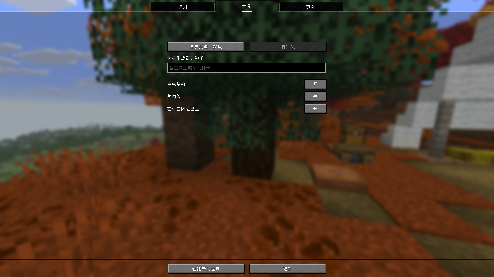
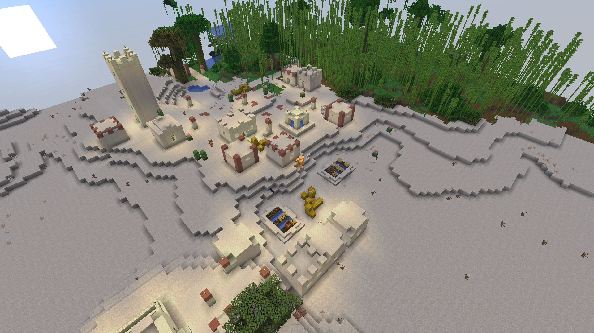

<p align="center"></p>

# World Reroll · 世界重开

[English](README.md) · [简体中文](README.zh-CN.md)

不满意这次生存开局？不用退出后删除存档、再重新填写世界参数。World Reroll 会沿用原世界设置，更换随机种子，也可以让你在村庄附近重新开始。

**Minecraft26.3 · Fabric / Quilt / Forge / NeoForge · Java25 · 单人世界**。另随包提供Fabric26.2、26.1.2，具体组合见[兼容矩阵](../COMPATIBILITY.md)。

> **新世界就绪后，重开会永久删除旧世界的地形、建筑、背包和进度。请只用于你确定要舍弃的世界。**

## 选择下一个开局

设置、确认、村庄准备与重试使用自身主题与 Minecraft 原生字体，原生世界加载和保存页面保留其回调，不读取或反射 Rodel UI。界面沿用Minecraft原生GUI缩放，正文溢出可滚动，底部操作保持可达；确认、取消与原生世界回调不变。

- **随机出生**：从新种子的自然出生点开始探索。
- **村庄附近**：寻找已有村庄，将玩家和世界出生点移到附近有稳固地面、上方空间无遮挡的位置。这是在生成世界后调整出生点，并非筛选自然出生在村庄旁的种子。
- **保留原有设置**：沿用游戏模式、难度及难度锁定、游戏规则、世界生成器、结构和奖励箱选项、启用的功能及世界数据包。
- **简短的存档目录名**：新目录使用 `HelloWorld-reroll-1` 这样的名称，重名时跳过并递增编号，不重命名已有存档。

关闭结构生成时，“村庄附近”会显示不可选原因。寻找村庄有范围上限，可能需要等待；没有找到村庄或合适地面时，旧世界会保留。出生偏好会在本次游戏会话中记住。

准备过程可以取消，服务器继续运行，同时最多有两个原生区块请求在途。通过真实结构起点确认村庄，传送前准备安全落脚点及周围 3×3 个完整区块。土径、薄雪和厚雪均可正常作为落脚地形；准备中的玩家受临时保护，不修改存档里的无敌设置。

开启“奖励箱”时，会把原版未打开奖励箱的战利品表和种子迁到最终村庄出生点附近的可打开位置，不会搬走村庄里的普通箱子。如果原版未能放置奖励箱，则在最终出生点补上一个。

## 创建新世界时就在村庄附近出生

在 **创建新的世界 → 世界** 页面中，打开 **在村庄附近出生**，它与“生成结构”“奖励箱”放在同一组选项里。每次打开新的创建界面时默认关闭，需要启用结构生成。你指定的种子和其他世界设置照常使用，只调整初始玩家位置、世界出生点以及已启用的奖励箱。



直接创建世界的流程不会删除其他存档。村庄定位失败时，会显示提示并保留刚创建的世界，你可以继续游玩。这个选项不会保存删除请求，也不会在日后载入世界时再次移动出生点。



*实际生成的新世界中的村庄，使用旁观视角展示；这不是玩家刚出生时的视角。*

## 安装

| 项目 | 支持范围 |
| --- | --- |
| Minecraft Java 版 | 26.3 / 26.2 / 26.1.2，使用对应目标产物 |
| 模组加载器 | 兼容矩阵中已验收的Fabric、Quilt、Forge或NeoForge目标 |
| 前置模组 | Fabric/Quilt需要匹配Fabric API；原生Forge/NeoForge包不需要它 |
| Java | 25 或更新版本 |
| 运行环境 | 单人客户端；多人服务器和已对局域网开放的世界不可使用 |

1. 在实例中准备受支持的Minecraft版本和加载器。
2. 在“内容 → 模组 → 内置模组”勾选World Reroll，点击“安装所选”；按实际环境选择精确包和依赖。
3. 启动该实例。模组由启动器随包提供，安装时不访问社区分发。

不需要安装 Lithergy。不同Minecraft目标分别构建，请使用与实例版本一致的产物；启动器的内置安装入口会自动选择对应目标。

## 使用

1. 进入单人世界，按 **Esc**。
2. 点击“保存并退回到标题画面”旁边的 **重开**。
3. 在面板中选择出生偏好，点击 **继续**。
4. 阅读删除提示后点击 **换个世界**；也可以取消并继续原世界。

旧世界会先按正常流程保存并关闭。模组再创建独立的新存档、更换种子并复制世界数据包。只有新世界连续 20 个客户端刻可正常游玩后，才开始删除来源存档。村庄模式先等客户端收到新的位置及周围全部 9 个区块，再开始这段稳定等待。取消或重试只释放本次准备自己的临时票据，保留锁定的最初来源。

## 哪些保留，哪些重置？

| 保留 | 重置 |
| --- | --- |
| 世界显示名称、游戏模式、难度及锁定 | 地形和建筑 |
| 已保存的全部游戏规则，包括进入游戏后修改的规则 | 背包、玩家状态和进度 |
| 世界生成器、结构和奖励箱选项 | 世界种子 |
| 启用的功能及世界数据包 | 其他模组自行保存的世界状态 |

即使打开了“死亡后保留物品”等规则，新世界仍会从新的背包和进度开始。替换原版世界载入流程或依赖自定义存档状态的模组，需要另外验证兼容性。

## 失败处理

- 开始前取消、创建失败或村庄出生点准备失败，都会保留来源世界。
- 失败页可点“再试一次”，沿用最初来源世界的设置和出生偏好换一个种子；也可点“返回”或按Esc退出。只有重试的新世界就绪后才删除最初来源，失败生成的世界继续保留。
- 重启游戏不会恢复执行尚未完成的删除请求。
- 删除对象只限本次来源存档，使用独立标记和文件系统元数据核对身份；链接或被重定向的目录会被拒绝。
- 清理失败会在游戏内提示并记录日志。删除已经开始后，失败可能留下部分清理结果；新世界仍可使用。
- 创建失败的新存档会保留，便于排查。崩溃可能留下 `.worldreroll-*` 标记文件，它们本身不会触发删除。

遇到问题请提交到 [GitHub Issues](https://github.com/Richasy/WorldReroll/issues)，附上游戏和模组版本、复现步骤及相关日志片段。

## 开发与验证

本模块位于`mods/world-reroll`，保持独立Gradle工程，不加入.NET解决方案。Fabric/Quilt包依赖匹配Fabric API，原生Forge/NeoForge包只依赖对应加载器与游戏；不强制依赖启动器、Rodel UI或开发目录。迁入基线和验证见[验证说明](docs/VALIDATION.md)。

当前正式源码以启动器仓库内的本模块为准，不使用旧独立仓库作为交付来源。版本继续由 `mods/gradle.properties` 统一管理。票据注册、服务器 tick／关闭和临时玩家保护通过共用原生 Mixin 接线，不向 Forge／NeoForge 包引入 Fabric 专属初始化器。

从启动器仓库根目录进入本模块，使用 JDK 25 和模块自带的 Gradle wrapper：

```powershell
cd .\mods\world-reroll
.\gradlew.bat build --no-daemon
.\gradlew.bat runClientGameTest --no-daemon
```

10项单元测试覆盖流程状态、存档身份、命名及数据包。真实客户端测试覆盖小窗口界面、取消、参数和数据包保留、延迟删除、局域网限制、村庄出生及失败保留。测试只使用`build/run/clientGameTest`下的临时世界，手动开发使用`run/client`，不要对个人存档运行删除测试。详见[验证说明](docs/VALIDATION.md)。

## 许可证与致谢

采用 [MIT](LICENSE) 许可证。使用流程受到 [Start Reroll](https://github.com/euruseve/StartReroll) 启发，代码通过 Minecraft 26.3 API 独立实现。代码、翻译和文档由 AI 辅助开发，图标通过 Azure ImageGen 生成。文档中的游戏截图均来自 Minecraft 实际运行，并非生成图片。

## 外观设置

从模组列表配置或重开选项页右上角进入，选择浅／深色并完成，保存到 `config/worldreroll-client.properties`；取消不改动。Fabric／Quilt 列表配置使用可选 Mod Menu，Forge／NeoForge 使用原生模组列表。主题仅属于本模组，不跟随启动器或其它模组。
